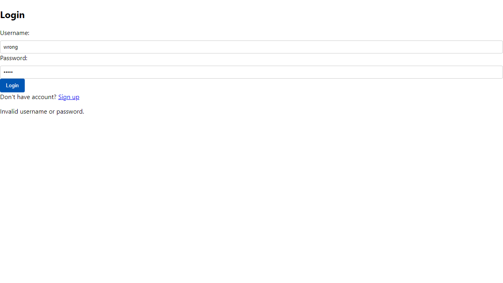
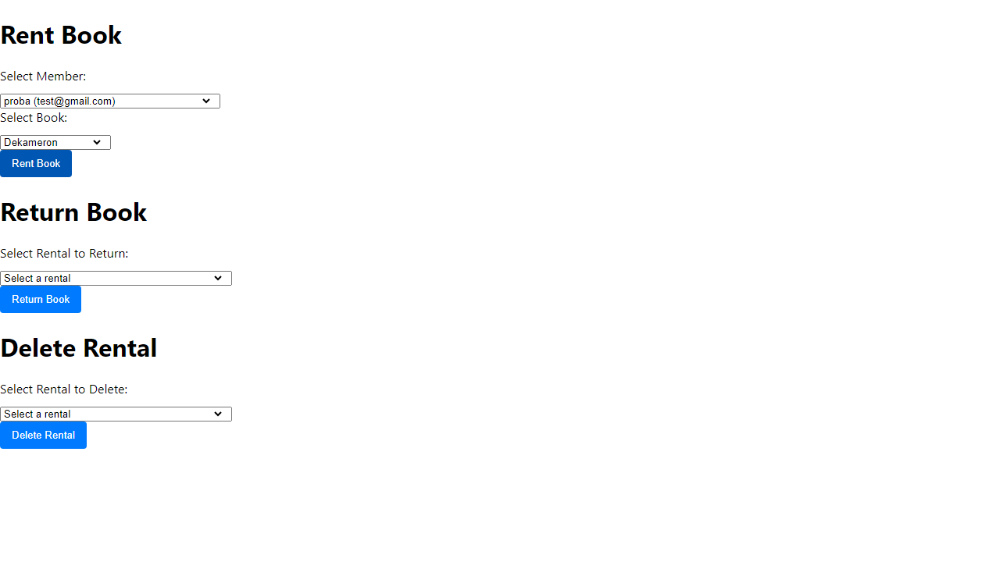
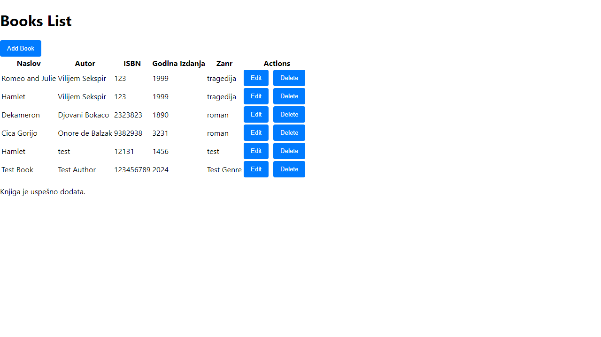

# Software Testing and Quality – Library Management System

A university project for the **Software Testing and Quality** course. It covers a library management REST API built with **ASP.NET Core 8**, tested on two levels:

- **Unit tests** for every API controller, written with **NUnit** and **EF Core InMemory**
- **End-to-end UI tests** for the main user flows, written with **Playwright** and run on Chromium, Firefox and WebKit

## The application

The backend manages a small library: members, books, rentals and reservations.

| Controller              | Responsibility                                                            |
|-------------------------|---------------------------------------------------------------------------|
| `ClanController`        | Member registration, login, profile update and deletion                   |
| `KnjigaController`      | Book CRUD                                                                 |
| `IzdavanjeController`   | Renting and returning books, with reservation conflict checks             |
| `RezervacijaController` | Creating, updating and deleting reservations, with date-overlap validation |

**Business rules covered by tests:**
- A book can't be rented if another member has reserved it within the next 14 days.
- A new reservation can't start before the current reservation's return date.
- Updated reservations can't overlap existing ones for the same book.
- Usernames must be unique, and passwords are salted and hashed (HMAC-SHA256).

**Stack:** C# · ASP.NET Core 8 Web API · Entity Framework Core 8 · SQL Server (LocalDB) · Swagger

## Test suite

### Unit tests (NUnit)

51 tests across four fixtures. Each fixture runs against a fresh **EF Core InMemory** database seeded with test data, so no real database is needed.

| Fixture           | Tests | What is covered                                                                                      |
|-------------------|:-----:|------------------------------------------------------------------------------------------------------|
| `ClanTest`        | 13    | Registration (success, duplicate username, empty password), login, get, update, delete               |
| `KnjigaTest`      | 11    | Get all / by ID, add (incl. required-field validation), update (incl. ID mismatch), delete           |
| `IzdavanjeTest`   | 15    | Renting with and without reservations, reservation conflicts, returning a book, get, delete          |
| `RezervacijaTest` | 12    | Adding (incl. invalid book/member and date conflicts), get, update, delete                           |

The tests cover both the happy path and the error cases (`404 Not Found`, `400 Bad Request`) for each endpoint. Parameterized cases use `[TestCase]`.

### End-to-end tests (Playwright)

16 UI scenarios, each run on **Chromium, Firefox and WebKit** (48 runs in total). Every test takes before/after screenshots as visual evidence.

| Spec                  | Scenarios                                                       |
|-----------------------|-----------------------------------------------------------------|
| `login.spec.ts`       | Successful login · error on wrong credentials                   |
| `register.spec.ts`    | Successful registration · error on existing username            |
| `books.spec.ts`       | Add · edit · delete a book                                      |
| `members.spec.ts`     | Load members list · edit · delete a member                      |
| `rental.spec.ts`      | Issue · return · delete a rental                                |
| `reservation.spec.ts` | Display books · add a reservation · delete a reservation        |

<details>
<summary>Screenshots captured by the E2E tests</summary>

| Failed login | Book rented |
|---|---|
|  |  |

| Before adding a book | After adding a book |
|---|---|
|  |  |

All screenshots are in [`Playwright-testovi/Slike`](Playwright-testovi/Slike).
</details>

## Project structure

```
.
├── Aplikacija/Library_back_final/Library_back/   # ASP.NET Core Web API
│   ├── Controllers/                              # Clan, Knjiga, Izdavanje, Rezervacija
│   ├── Models/                                   # Entities + IspitContext (DbContext)
│   └── Migrations/                               # EF Core migrations
├── Library_test/Library.Tests/                   # NUnit unit tests
└── Playwright-testovi/                           # Playwright E2E tests
    ├── tests/                                    # *.spec.ts
    ├── Slike/                                    # Screenshots produced by the tests
    └── playwright.config.ts
```

## Running the project

### Prerequisites

- [.NET 8 SDK](https://dotnet.microsoft.com/download)
- SQL Server LocalDB (only needed to run the API, not the unit tests)
- Node.js 18+ (for Playwright)

### Unit tests

```bash
cd Library_test/Library.Tests
dotnet test
```

### API

The API uses the `LibraryCS` connection string from `appsettings.json` (`Server=(localdb)\Library;Database=LibraryQA`).

```bash
cd Aplikacija/Library_back_final/Library_back
dotnet ef database update
dotnet run
```

Swagger UI opens at `https://localhost:7080/swagger`.

### End-to-end tests

The E2E tests target the frontend at `http://localhost:3000`, which calls this API. Start both first, then run:

```bash
cd Playwright-testovi
npm ci
npx playwright install
npx playwright test
npx playwright show-report      # open the HTML report
```

